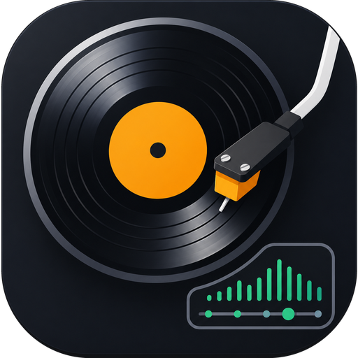
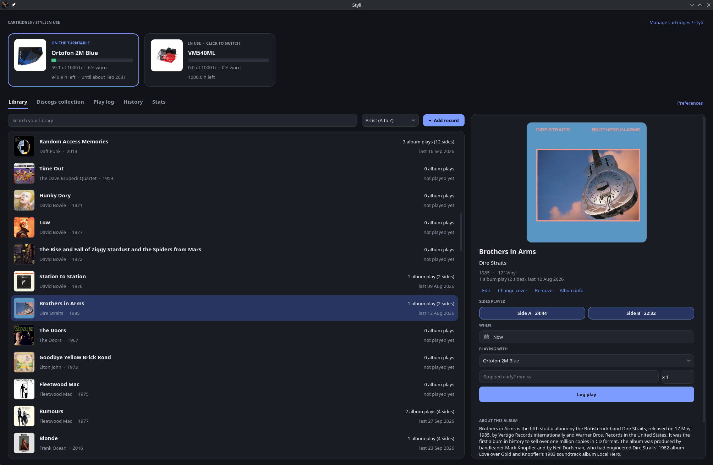
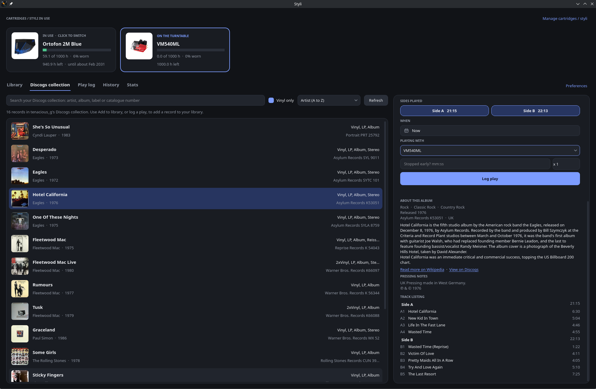
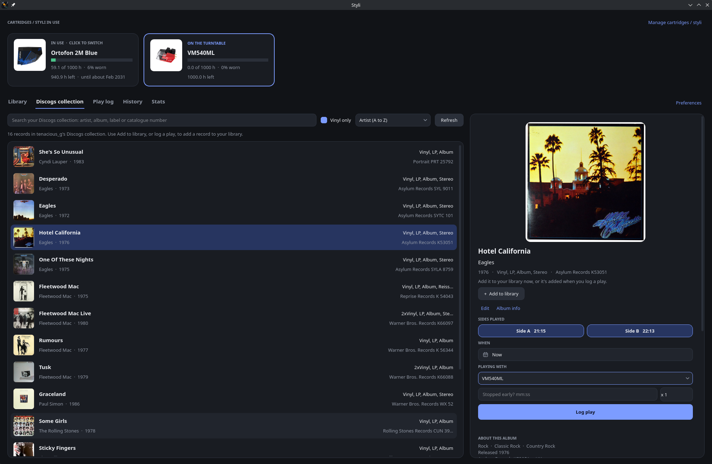
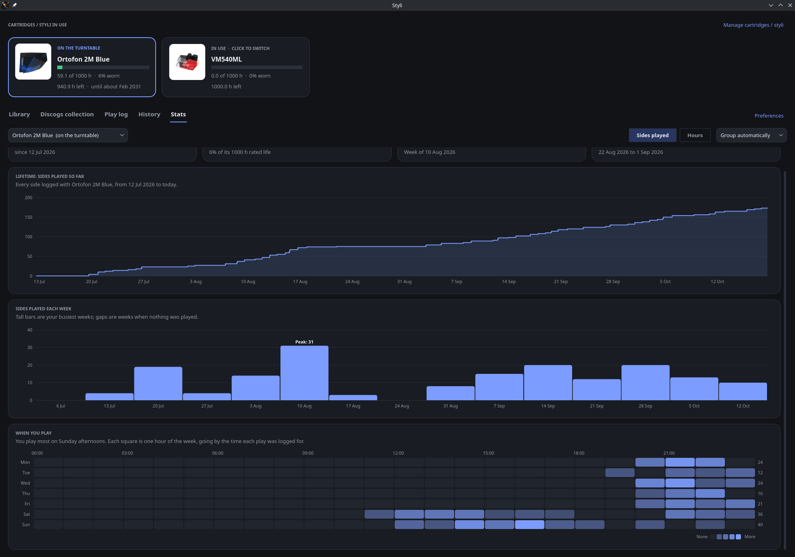
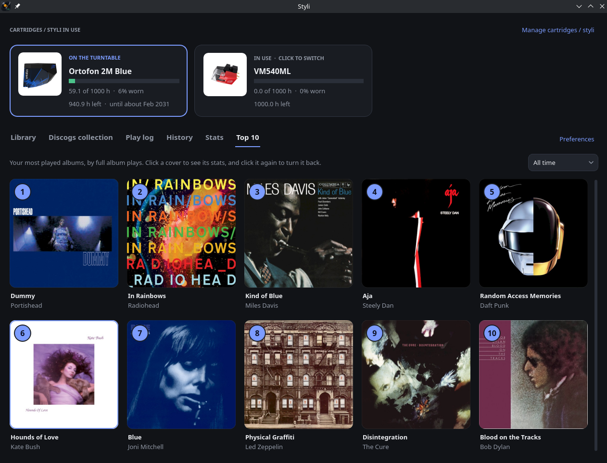
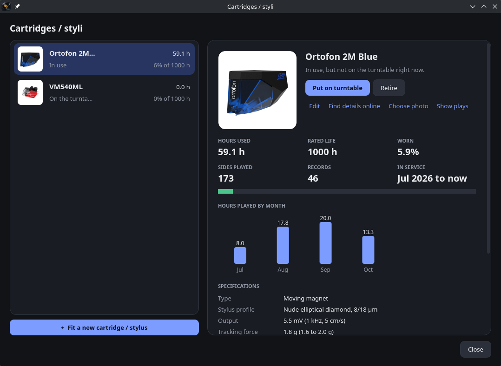
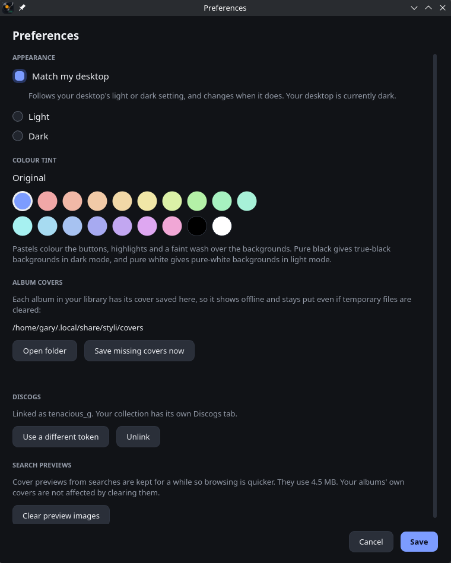

<p align="center">
  
</p>

<h1 align="center">Styli</h1>

<p align="center">
  <strong>Log your vinyl plays by side, and know how much life is left in your stylus.</strong><br>
  A desktop app and command-line tool for Linux, macOS and Windows.
</p>

---

Every stylus wears out. Manufacturers give a rated life in hours, but few of us know how many hours we've actually played. Styli keeps count for you: log a record (or just one side of it) and Styli adds its exact running time to the cartridge / stylus on your turntable, using side lengths looked up automatically from [MusicBrainz](https://musicbrainz.org).

Along the way it builds a picture of your listening: what you play most, when in the week you play, and how your listening has changed over the life of each stylus.
















## Contents

- [Features](#features)
- [Installing](#installing)
- [Getting started](#getting-started)
- [Using the window](#using-the-window)
- [Using the command line](#using-the-command-line)
- [Your data](#your-data)
- [Privacy and security](#privacy-and-security)
- [Trying it with the demo library](#trying-it-with-the-demo-library)
- [Files in this project](#files-in-this-project)
- [How the code is organised](#how-the-code-is-organised)
- [Troubleshooting](#troubleshooting)
- [Credits and data sources](#credits-and-data-sources)
- [Licence](#licence)

## Features

**Your record library**
- Add albums by searching [MusicBrainz](https://musicbrainz.org) by artist and title, or by the barcode on the sleeve. Searches find albums by the artist you typed only, so tribute and cover albums stay out of the way.
- Pick the exact pressing you own. Side running times are worked out from the track list (A1, A2, B1...), so each side is timed separately.
- Or pick records straight from your [Discogs](https://www.discogs.com) collection, or enter one by hand.
- Album covers from the Cover Art Archive or Discogs, saved with your library so they work offline.
- A summary of each album (genres, release details, Wikipedia's introduction) and its full track listing.
- Sort your library by artist, album, year, date added, last played or most played.

**Logging plays**
- Log the whole record, chosen sides, the same side twice, or a side you stopped part-way through.
- Log plays from earlier with a date and time picker. Days you've already logged plays on are marked.
- Undo a play straight away, or remove any play later from the play log.

**Cartridges and styli**
- Track several cartridges / styli at once, with one "on the turntable" that plays are logged against.
- See hours used, hours left and a wear bar, with warnings at a level you choose and when the rated life is reached.
- An estimate of when each will reach its rated life, based on how much you've been listening lately.
- Retire a worn stylus and keep its history. Fetch a photo and specifications from Wikipedia or a product page.

**Stats**
- A lifetime chart of each cartridge / stylus, sides played per day, week or month (quiet spells show as gaps) and a weekly heatmap of when you play. Drag the charts into the order you like.
- A Top 10 of your most played albums as a grid of covers. Click one to flip it over and see its stats.

**Look and feel**
- Light, dark or "match my desktop" themes, with 16 pastel tints plus pure black and pure white.
- A resizable album panel and charts that fit the window.

## Installing

Styli is a small Python program: the `styli.py` launcher and the `styli_app` folder beside it (keep them together). The commands need only Python itself; the window also needs PyQt6. The [keyring](https://pypi.org/project/keyring/) package is optional and keeps a Discogs access token in your system's secure credential store (see [Privacy and security](#privacy-and-security)).

You need **Python 3.9 or newer**.

### Linux

1. Install PyQt6 (and, optionally, keyring) from your distribution:

   | Distribution | Command |
   |---|---|
   | Debian, Ubuntu, Mint | `sudo apt install python3-pyqt6 python3-keyring` |
   | Fedora | `sudo dnf install python3-pyqt6 python3-keyring` |
   | Arch, Manjaro | `sudo pacman -S python-pyqt6 python-keyring` |

2. Download the project (or clone it), then from its folder run:

   ```sh
   sh install.sh
   ```

   This copies Styli into `~/.local/share/styli/app`, creates the `styli` command in `~/.local/bin`, and adds Styli with its icon to your applications menu. It tells you if anything is missing. Run it again at any time to update; your library is never touched.

3. Open **Styli** from your applications menu, or run `styli gui`.

If the `styli` command isn't found, add `~/.local/bin` to your PATH (the installer shows you the line to add to `~/.profile`).

### macOS

1. Install Python 3 from [python.org](https://www.python.org/downloads/) or Homebrew (`brew install python`).
2. Install PyQt6 and keyring:

   ```sh
   python3 -m pip install PyQt6 keyring
   ```

3. From the project folder, open the window:

   ```sh
   python3 styli.py gui
   ```

   Or use any of the commands, for example `python3 styli.py status`.

### Windows

1. Install Python 3 from [python.org](https://www.python.org/downloads/) and tick **Add python.exe to PATH** during setup.
2. In a terminal (PowerShell or Command Prompt), install PyQt6 and keyring:

   ```powershell
   py -m pip install PyQt6 keyring
   ```

3. From the project folder, open the window:

   ```powershell
   py styli.py gui
   ```

   Or use any of the commands, for example `py styli.py status`.

On macOS and Windows, `styli` in the examples below means `python3 styli.py` or `py styli.py`.

### A note for MusicBrainz

MusicBrainz asks every app to identify itself. Styli does, but you can add your own contact details (an email address or web page) so MusicBrainz can get in touch if anything goes wrong:

```sh
export STYLI_CONTACT="you@example.com"      # Linux and macOS
setx STYLI_CONTACT "you@example.com"        # Windows
```

## Getting started

1. **Add your cartridge / stylus.** Open **Manage cartridges / styli** (or run `styli stylus add "Ortofon 2M Red" --hours 1000`). Use the manufacturer's rated life in hours; if it isn't new, say how many hours it has already done.
2. **Add a record.** Click **+ Add record**, search for the artist and album, choose the pressing you own and check the side lengths.
3. **Log a play.** Select the record, leave the sides you played switched on and click **Log play**. That's it: the time is added to the cartridge / stylus on your turntable.

## Using the window

| Tab | What it's for |
|---|---|
| **Library** | Your records. Select one to see its cover, log a play, and read its summary and track listing. |
| **Discogs collection** | Appears once you link a Discogs account. Log plays of records in your collection, or add them to your library. |
| **Play log** | Each time you logged a play, newest first. Remove one played by mistake. |
| **History** | Every side played, which you can filter by cartridge / stylus. Export it as a CSV file. |
| **Stats** | Charts for the cartridge / stylus on your turntable (or any other): its lifetime, plays per day, week or month, and a weekly heatmap. Switch between sides played and hours. Drag the charts by their handles to reorder them. |
| **Top 10** | Your most played albums as covers, for all time or the past year, three months or month. Click a cover to see its stats on the back. |

The cards along the top show each cartridge / stylus in use; click one to put it on the turntable. On a smaller screen, **Hide cards** swaps them for a one-line summary to give the tabs more room.

**Preferences** (Ctrl+,) has the theme and tint, your Discogs account and the cover cache.

### Linking Discogs

Create a personal access token on your [Discogs developer settings page](https://www.discogs.com/settings/developers), then paste it into **Preferences > Link Discogs account** (or run `styli discogs link <token>`). Styli only reads your collection; it never changes anything on Discogs.

## Using the command line

Everything the window does can also be done from a terminal. Records and cartridges can be referred to by number or by a few words of their name.

```sh
# Cartridges / styli
styli stylus add "Ortofon 2M Red" --hours 1000          # fit one (it goes on the turntable)
styli stylus add "Ortofon 2M Blue" --hours 1000 --replaces "2M Red"   # replace one, retiring the old
styli stylus list                                       # all of them, in use and retired
styli stylus use 2                                      # put another one on the turntable
styli stylus show 2                                     # hours, specifications and monthly use
styli stylus lookup 2 --url <product page>              # fetch a photo and specifications

# Records
styli add fleetwood mac rumours                         # search MusicBrainz, then pick your pressing
styli add --artist "the rolling stones" --title "some girls"
styli add --barcode <number under the barcode>          # by the barcode on the sleeve
styli add --discogs rumours                             # from your Discogs collection
styli add --manual --artist "Band" --title "Album" --side A=19:22 --side B=20:21
styli list
styli info rumours                                      # summary and track listing
styli side rumours B 20:21                              # correct a side's length
styli covers                                            # fetch any missing album covers

# Plays
styli play rumours                                      # both sides, just now
styli play 3 B                                          # side B of record 3
styli play "dark side" --when "yesterday 21:00"
styli play rumours A --duration 12:30                   # stopped part-way through
styli log                                               # the play log
styli undo                                              # remove the last play logged

# Reports
styli status                                            # wear on each cartridge / stylus
styli stats                                             # lifetime chart and weekly heatmap, as text
styli top --period quarter                              # most played albums, past 3 months
styli history -n 50
styli export plays.csv
```

Run `styli --help`, or `styli <command> --help`, for every option.

## Your data

Everything is kept in one SQLite database file, with album covers and cartridge photos beside it:

| System | Library folder |
|---|---|
| Linux | `~/.local/share/styli/` |
| macOS | `~/Library/Application Support/styli/` |
| Windows | `%APPDATA%\styli\` |

To use a library somewhere else, run Styli with `--db /path/to/library.db`, or set the `STYLI_DB` environment variable.

**Backing up:** copy the whole `styli` folder while Styli is closed. Cover previews from searches are kept separately in your system's cache folder and can be deleted at any time.

## Privacy and security

- Styli runs entirely on your computer. There's no account, no tracking and no server of its own. It only goes online to look up albums, covers, summaries and cartridge details, and to read your Discogs collection if you link it.
- On Linux and macOS, the library folder, database, covers and cache are readable by your user account only. On Windows, the AppData folders Styli uses are already private to each user.
- **Discogs token:** with the keyring package installed, your Discogs access token is kept in your system's secure credential store: GNOME Keyring or KWallet on Linux, Keychain on macOS, Credential Manager on Windows. Without it, the token is kept in the database. Preferences and `styli discogs status` say which.
- Each library has its own keyring entry, so a copy of your database on another computer doesn't carry your token with it.
- Deleted plays and records are overwritten inside the database file rather than left in its free space.

## Trying it with the demo library

`make_demo.py` builds a demo library of 100 well-known albums and about 80 listens over the last three months, with an Ortofon 2M Blue on the turntable:

```sh
python3 make_demo.py ~/styli-demo.db
styli --db ~/styli-demo.db gui
styli --db ~/styli-demo.db covers       # optional: fetch the album covers
```

The listens always end on the day you run it, so the demo never looks out of date. Your own library isn't touched.

## Files in this project

| File | What it is |
|---|---|
| `styli.py` | The launcher: run it to open the window (`styli.py gui`) or use the commands. |
| `styli_app/` | The program itself (see [How the code is organised](#how-the-code-is-organised)). |
| `styli.png` | The app icon. |
| `install.sh` | Installer for Linux. |
| `make_demo.py` | Builds the demo library. |
| `README.md`, `LICENSE` | This file, and the licence. |

## How the code is organised

The engine and the command line need only the Python standard library; only the `gui` folder uses PyQt6. Every module starts with a note on what it's responsible for, and `styli_app/__init__.py` has the full map.

| Module | What it does |
|---|---|
| `common.py` | The version, dates and durations, comparing names, questions at the terminal |
| `paths.py` | Where the library and caches are kept on each system |
| `privacy.py` | Private folders, and secrets in the system keyring |
| `db.py` | The SQLite database: schema, connecting, settings |
| `library.py` | Records and their sides |
| `plays.py` | Logging plays, the play log, play counts, CSV export |
| `stats.py` | Lifetime charts, the weekly heatmap, the Top 10 |
| `cartridges.py` | Cartridges / styli: which are in use, wear, photos and specifications |
| `cartridge_lookup.py` | Photos and specifications from Wikipedia and product pages |
| `web.py` | Fetching pages, and the error every lookup raises |
| `musicbrainz.py` | Finding albums and pressings, and timing each side |
| `covers.py` | Album art |
| `discogs.py` | Your Discogs collection as a source of records |
| `details.py` | Album summaries and track listings |
| `cli/` | The `styli` command: options and `main()` in `__init__.py`, then the commands by area (`cmd_records.py`, `cmd_plays.py`, `cmd_reports.py`, `cmd_cartridges.py`, `cmd_setup.py`) |
| `gui/` | The window: `theme.py`, `widgets.py`, `cover_views.py`, `tasks.py` (background work), `when.py` (date picker), `charts.py`; `window.py` with one module per tab (`tab_library.py`, `album_panel.py`, `tab_discogs.py`, `tab_playlog.py`, `tab_history.py`, `tab_stats.py`, `tab_top10.py`); `dialogs/`; and `app.py`, which starts it |

Engine modules refer to each other as `module.function` (for example `db.get_setting`), which keeps it clear where everything lives.

## Troubleshooting

**The window won't open.** PyQt6 isn't installed for the Python you're using, or the `styli_app` folder isn't next to `styli.py`. Install it (see [Installing](#installing)); `styli status` and the other commands still work without it.

**"could not reach MusicBrainz".** You're offline, or MusicBrainz is busy. Try again shortly. Records you've already added, and their covers, work offline.

**A side's length is wrong or missing.** Some MusicBrainz entries lack track lengths. Correct it with **Edit** in the album panel, or `styli side <record> <side> <mm:ss>`.

**Covers are missing for records entered by hand.** Run `styli covers` while online; Styli matches them to albums on MusicBrainz by artist and title. You can also choose your own image with **Change cover**.

**The Discogs tab says the token couldn't be read.** Your system keyring is locked. Unlock it (usually by logging in again), or link the account again in Preferences.

**The new icon doesn't show in the menu (Linux).** Some desktops cache icons. Log out and back in.

## Credits and data sources

- Album and track data: [MusicBrainz](https://musicbrainz.org), the open music encyclopaedia. Its core data is in the public domain ([CC0](https://creativecommons.org/publicdomain/zero/1.0/)).
- Album covers: the [Cover Art Archive](https://coverartarchive.org), a joint project of MusicBrainz and the Internet Archive. Cover images remain the property of their copyright holders.
- Album summaries and cartridge descriptions: [Wikipedia](https://en.wikipedia.org), available under [CC BY-SA 4.0](https://creativecommons.org/licenses/by-sa/4.0/).
- Collection data: [Discogs](https://www.discogs.com). Wherever Styli shows information from Discogs, it says "Data provided by Discogs." with a link to the page it came from.

This application uses Discogs’ API but is not affiliated with, sponsored or endorsed by Discogs. ‘Discogs’ is a trademark of Zink Media, LLC.

Styli is an independent project and isn't affiliated with any cartridge or stylus manufacturer. Product names are used only to identify the cartridges you own.

## Licence

Styli is released under the MIT Licence: you're free to use, change and share it. See the `LICENSE` file for the full text.
